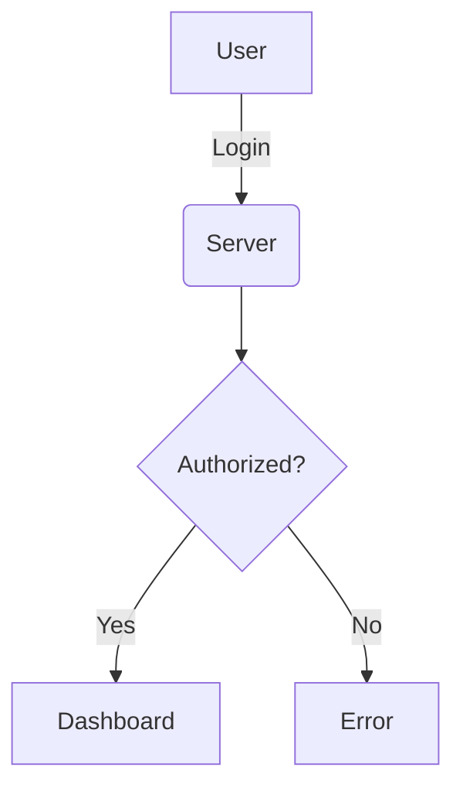

> [!NOTE]
> This new version is developed with AI, I have just provided the core content and let it do its thing. (so far) :rocket:

# Markdown for READMEs 📓

## Outlines

  * [Typography & Text](#typography--text)
  * [Lists](#lists)
  * [Links & Images (The Clean Way)](#links--images-the-clean-way)
  * [HTML Magic](#html-magic-for-formatting)
  * [Code & Syntax](#code--syntax)
  * [Visuals & Charts](#visuals--charts)
  * [Tables](#tables)
  * [Callouts](#callouts)
  * [Hints](#hints)

-----

## Typography & Text

### Headlines


```markdown
# Headline 1
## Headline 2
### Headline 3
#### Headline 4
```

# Headline 1

## Headline 2

### Headline 3

#### Headline 4


### Separator

Three dashes create a horizontal rule.

```markdown
---
```

---


### Formatting

```markdown
**Bold** or __Bold__
*Italic* or _Italic_
~~Strikethrough~~
```


  * **Bold** or **Bold**
  * *Italic* or *Italic*
  * \~\~Strikethrough\~\~

<!-- end list -->


### Quotes

> In jest, there is truth

```markdown
> In jest, there is truth
```

-----


## Lists


```markdown
<!-- unordered list -->
* Item A
* Item B
```

**Unordered list**

  * Item A
  * Item B

```markdown
<!-- ordered list -->
1. Step One
2. Step Two
```

**Ordered list**

1.  Step One
2.  Step Two


```markdown
<!-- nested list -->
1. Main Item
    1. Sub A
    2. Sub B
```

**Nested list**

1.  Main Item
    1.  Sub A
    2.  Sub B
2.  Main Item Two


```markdown
<!-- task list -->
* [ ] Task to do
* [x] Task done
```
**Todos (Task List)**

  * [ ] Task to do
  * [x] Task done

-----

## Links & Images (The Clean Way)

### Standard Links

```markdown
[Google](https://google.com)
[Go to Headlines](#headlines)
```

[Google](https://google.com)
[Go to Headlines](https://www.google.com/search?q=%23headlines)


### Reference Style (Clean Code) 🧹

*Best for keeping your raw markdown readable when using long URLs.*

```markdown
This is a [link to Google][ref1].
And here is a badge image:
![Build Status][ref2]

[ref1]: https://google.com
[ref2]: https://img.shields.io/badge/Build-Passing-green.svg
```

This is a [link to Google][ref1].
And here is a badge image:


-----

## HTML Magic (For Formatting)

Sometimes Markdown isn't enough. You can use raw HTML!

### Centering & Resizing Images

```html
<div align="center">
  
  <br>
  <sub>This is a centered, resized image with a caption</sub>
</div>
```


<div align="center">
  
  <br>
  <sub>This is a centered, resized image with a caption</sub>
</div>


### Collapsible Sections


```html
<details>
<summary>Click to see the secret content!</summary>

Here is the hidden content.
</details>
```


<details>
<summary>Click to see the secret content!</summary>
Here is the hidden content.
</details>

-----

## Code & Syntax

### Inline Code

````markdown
Install via `npm install`
````

Install via `npm install`

### Blocks

````markdown

```python
def hello():
    print("Hello World")
```
````

```python
# python example
def hello():
    print("Hello World")
```


````markdown

```json
{
  "key": "value"
}
```
````

```json
{
  "key": "value"
}
```

### Diff (Good for git changes)

````markdown

```diff
- var old = "bad";
+ var new = "good";
```
````

```diff
- var old = "bad";
+ var new = "good";
```


-----

## Visuals & Charts

### Mermaid JS (Native in GitHub)

You can draw diagrams directly in code blocks\!

````markdown

````


### QuickChart (External API)

If Mermaid isn't supported, use QuickChart to render charts as images.

```markdown

```

-----

## Tables

| Command | Description | Status |
| :--- | :---: | ---: |
| `git status` | List changes | Basic |
| `git commit` | Save changes | **Important** |

```markdown
| Command | Description | Status |
| :--- | :---: | ---: |
| `git status` | List changes | Basic |
| `git commit` | Save changes | **Important** |
```

*(Note: colons adjust alignment. Left `:---`, Center `:---:`, Right `---:`)*

-----

## Callouts

> [!NOTE]
> Useful information here.

> [\!WARNING]
> Be careful with this step\!

> [\!TIP]
> Try pressing `Alt + F4` (Just kidding).

```markdown
> [!NOTE]
> text...

> [!WARNING]
> text...

> [!TIP]
> text...
```

-----

## Hints

1.  You can add a GIF image, but not a video file? Use **asciinema** for terminal recordings.
1.  Check the :point\_right: [emoji cheat sheet](https://github.com/ikatyang/emoji-cheat-sheet).

-----

<!-- 
## A BIG SECRET

Shh\! 🤫

OK, I cannot keep the **secret** anymore...

Do you have Messenger, WhatsApp, or Discord? You can use **Markdown** there too\!

  * for bold text, `*bold*`
  * for italic,  `_italic_`
  * for strikethrough, `~strike~`-->


## If you like it, feed me. I go on a diet of stars 💫

[ref1]: https://www.google.com/search?q=%5Bhttps://google.com%5D\(https://google.com\)
